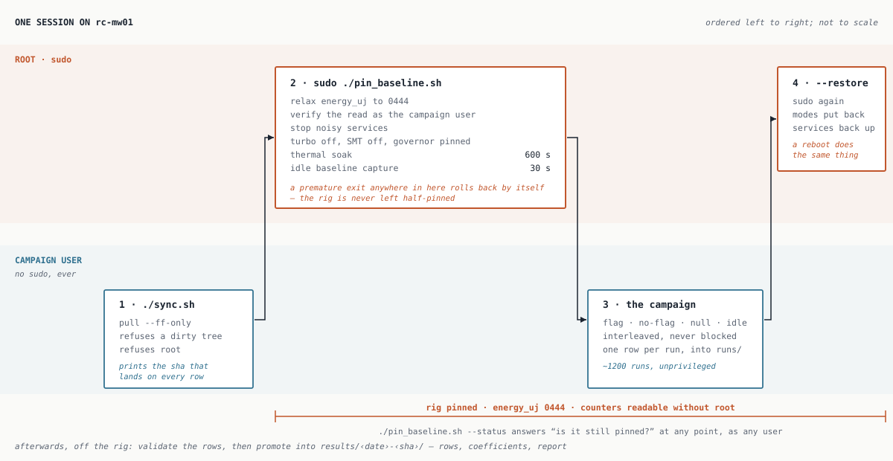

# etdc/rig — tier 3, the measurement rig

The scripts that run on the dedicated Linux measurement box (`rc-mw01`, an old
Lenovo with Intel RAPL), not on a dev machine. See
[energy-aware-code-analysis-plan.md](../../energy-aware-code-analysis-plan.md),
section "d) Calibration rig and methodology", for why this tier exists; this
file covers how to operate it.

**The rig is an instrument for validating rules, not for improving programs.**
It measures a `flag` arm against a `no-flag` control and reports a decoupling
quotient — a quality score for the detector. The second arm is a control, not
a recommended rewrite.

RAPL is the primary measurement path. The Shelly plug is validation-tier only:
it sanity-checks RAPL against true wall power and never replaces it.



A second drawing, [parent-child.svg](parent-child.svg), shows the structure of
a single run — what the parent does, what the child does, and what the measured
window contains. Both depict the design as intended; they are not a progress
tracker.

---

## Runbook

### Once, to set the rig up

```sh
git clone <repo-url> ~/energy-advisor      # as the campaign user, NOT root
cd ~/energy-advisor
python3 -VV                                # must be 3.12+; 3.14.4 as of writing
```

**Which branch the rig tracks.** `main` by default, which is what a fresh
clone gives you. Checking out a feature branch to measure work in flight is
legitimate — often it is the whole point of having a rig — but a campaign you
intend to *promote* should cite a sha reachable from `main`, or the published
result references code that may be rebased away or never merged. `sync.sh`
fast-forwards whatever branch is checked out; it does not pick one for you.

The checkout must be owned by the user who will run campaigns. `sudo` is for
`pin_baseline.sh` and nothing else — a root `git pull` leaves root-owned files
in a tree the campaign user has to write to.

The Python version is not a detail. CPython 3.12 inlined list/set/dict
comprehensions (PEP 709) but **not** generator expressions, which is the exact
asymmetry the eager-materialization rule rests on. Rows from two versions are
not poolable, and the manifest pins an exact version.

### Every session

```sh
cd ~/energy-advisor
etdc/rig/sync.sh                           # 1. fast-forward; prints the HEAD sha

cd etdc/rig
sudo ./pin_baseline.sh --dry-run           # 2. preview; changes nothing
sudo ./pin_baseline.sh                     # 3. pin + relax + soak + baseline

# 4. run the campaign (unprivileged) — see "Running a measurement" below

sudo ./pin_baseline.sh --restore           # 5. put the machine back
```

Step 2 is worth doing every time on a rig you have not pinned recently. It
prints the pre-change `energy_uj` modes and exercises every path without
touching anything.

Step 3 takes **about eleven minutes** — a 600 s thermal soak then a 30 s idle
baseline. It fails fast if it is going to fail: RAPL permissions are relaxed
and verified in the first second, before the soak, specifically so you do not
wait ten minutes to find out the campaign user cannot read the counters.

### Checking state at any point

```sh
./pin_baseline.sh --status                 # no root needed
```

Run it **as the campaign user**: besides reporting what is pinned and the
current-vs-original RAPL modes, it tells you whether *that user* can read the
counters, which is the question that decides whether a campaign will start.

### Running the ratio(N) sweep

The full campaign runner does not exist yet. `sweep.py` does one pair across
the N ladder, which is what the report and the demo are built around:

```sh
cd ~/energy-advisor                        # must be the repo root
./etdc/rig/sync.sh                         # pull-only, --ff-only, refuses a dirty tree

python3 -s -m etdc.rig.sweep --dry-run     # prints the R ladder and the run count

mkdir -p etdc/rig/runs
python3 -s -m etdc.rig.sweep \
    --rule eager-materialization --pair sum_list \
    --out etdc/rig/runs/$(date -u +%Y%m%dT%H%M%SZ)-sum_list.jsonl
```

Defaults are N = 50k/100k/200k/400k/800k at 10 reps — 100 child runs, 10
calibration probes and 5 idle windows, a few minutes of rig time. `--dry-run`
prints the exact counts. Start with `--ladder 200000 --reps 2` to confirm the
path end to end before spending the real sweep.

`sweep.py` pins itself to core 0 and each child to core 1, pins
`PYTHONHASHSEED=0`, refuses to run against a dirty tree (`--allow-dirty`
stamps the rows instead), and appends one flushed row at a time, so a sweep
killed halfway keeps everything it already measured. It needs no `sudo` —
`pin_baseline.sh` has already relaxed `energy_uj` for the session.

**Do not pass `--no-pin` on the rig.** It exists so the rotation can be
exercised on a dev Mac, where `taskset` and `sched_setaffinity` do not exist.
It stamps `pinned: false` on every row, because an unpinned row is not a
cheaper measurement — it is an uncalibrated one that reads exactly like a real
one.

Then read the rows, on the rig or after copying them off:

```sh
python3 -s -m etdc.rig.decouple etdc/rig/runs/*.jsonl --json /tmp/summary.json
python3 -s -m etdc.rig.chart /tmp/summary.json --svg ratio-n.svg --table ratio-n.md
```

`decouple.py` reports raw and idle-subtracted side by side and never clamps a
negative `E_active`, pools rows from two interpreters, or drops a failed row
silently — failures are counted and named. Read its notes before believing the
table: that is where a stale baseline, a short window or a dead counter
appears.

**Rows have to come back off the rig yourself.** `sync.sh` is pull-only *onto*
the rig, so it will not carry rows the other way:

```sh
# from the dev machine
scp rc-mw01:energy-advisor/etdc/rig/runs/*.jsonl etdc/rig/runs/
```

### Running a single measurement

One run at a time, for a sanity check or a hand-measured row:

```sh
cd ~/energy-advisor                        # must be the repo root
PYTHONHASHSEED=0 taskset -c 1 python3 -s -m etdc.rig.harness \
    benchmarks/eager-materialization/flag/sum_list.py \
    --n 200000 --r 500 --warmup 2 --out /tmp/run.json
```

Three things in that line matter:

- **`python3 -m` from the repo root.** `-m` puts the working directory on
  `sys.path`, which is how `etdc.rig.harness` resolves with no `pip install`
  and no `PYTHONPATH`. Running `python3 etdc/rig/harness.py` will not work.
- **`PYTHONHASHSEED=0`.** Set construction and membership go through `hash()`,
  and the `max_set` pair exists to measure exactly that path. An unpinned seed
  injects variance into the arm under test.
- **`taskset -c 1`, not core 3.** `rc-mw01` has 4 logical CPUs with SMT on —
  2 physical cores, thread siblings `(0,2)` and `(1,3)` — so once
  `pin_baseline.sh` disables SMT only `cpu0` and `cpu1` remain online and
  `taskset -c 3` fails with `sched_setaffinity: Invalid argument`. Confirm the
  surviving set with `cat /sys/devices/system/cpu/online` after pinning. Core 1
  for the child leaves core 0 for the runner and everything else on the box —
  with only two cores there is no third place to put things. `taskset` itself
  needs no root: setting affinity on your own process is unprivileged, which is
  part of why the campaign needs no `sudo` at all.

A fixture also runs on its own, which is useful for a sanity check:

```sh
python3 benchmarks/eager-materialization/flag/sum_list.py 200000
```

### Off-rig, after a campaign

The rig only ever produces rows. Everything interpretive happens here, where
it can be re-run and argued with:

```sh
python3 -s -m etdc.rig.report etdc/rig/runs/*.jsonl --out results/
```

That runs the promotion checklist and, if it passes, writes
`results/<date>-<short-sha>/` holding `rows.jsonl` (verbatim, failures
included), `manifest.json`, `rig.json`, `coefficients.json`, `report.md` and
`charts/`. Raw rows in `runs/` stay gitignored scratch — every campaign,
including the bad ones; a promoted campaign is the subset worth citing.

**Promotion is a checkable list, not a judgment.** One interpreter, one SHA, a
clean tree, a pinned child, one RAPL domain set, an idle window to subtract,
no negative `E_active`, no window under the floor, at least three ratio pairs
per point. A failed check refuses to promote. `--anyway` promotes regardless
and archives the failures *in* the report — a reader who cannot see a
campaign's defects cannot tell it from a filtered one.

Failed *rows* are not themselves a failed check: they are retained verbatim
and tabulated. Silently dropping them is the one thing that would make the
archive untrustworthy.

The date and SHA in the directory name come from the rows, not from the clock,
so a campaign promoted a month late keeps the date it was measured — and
regenerating a promoted campaign should give an empty `git diff`. That is the
test that the report still matches the rows beside it.

**This is one view, not the view.** The rows are the artifact and every number
in the report is recomputable from them, so reporting differently is a
supported thing to do rather than a fork.

---

## When something goes wrong

| symptom | what it means |
|---|---|
| `pin_baseline.sh` exits part-way | It already rolled itself back. The trap is armed for the whole pinning sequence and disarmed only once the baseline is captured, so the rig is never left half-pinned. |
| `energy_uj is not readable as uid N` | The counters are back at 0400 — usually a reboot, since sysfs modes do not survive one. Re-run `pin_baseline.sh`. |
| `--restore` says "nothing to restore" | No state file. Either it was already restored, or the machine rebooted, which restores everything by itself. |
| campaign refuses to start | Dirty working tree. The sha on each row has to identify the code that produced it; `git status` and commit or revert. |
| `sync.sh` reports divergence | The rig has commits of its own, which should never happen. Inspect with `git log --oneline @{u}..HEAD`; do not resolve it automatically. |

**A reboot is a full restore.** Sysfs modes, cpufreq, SMT and stopped services
are all session state and none of it survives. If the rig is in an unknown
state and you cannot be bothered, reboot it.

---

## What is in here

### `rapl.py`

Reads `/sys/class/powercap/intel-rapl*` directly — not `pyRAPL`, whose
`DeviceAPIFactory` only builds `PkgAPI`/`DramAPI` and filters zones by name, so
it silently misses `psys`/`core`/`uncore` (all of which this rig exposes).

- `discover_domains(root=…)` — walks sysfs, sorts by path **before** assigning
  keys so both the order and the name→path mapping are reproducible, and
  trial-reads each `energy_uj` so an unreadable counter fails here rather than
  inside a measured window.
- `start(domains)` / `stop(domains, mark)` — brackets a workload. Both read
  counters then the clock, in that order, so the sysfs read overhead lands in
  both intervals and cancels in the subtraction. Returns raw per-domain deltas
  and computes no total.
- `sample(seconds, domains)` — an idle window is a window whose workload is a
  sleep, so this is three lines over the pair.

```sh
python3 rapl.py --seconds 30 --out baseline.json
```

### Which domains count

Confirmed on this rig; the decision is recorded in
[the plan doc](../../energy-aware-code-analysis-plan.md) and is **settled, not
open**:

- `core` and `uncore` are **subzones of `package-0`**, not separate rails.
  Adding them on top of package-0 double-counts.
- `dram` is a genuinely separate physical rail and **does** add to the package
  total. (Most client chips do not expose it at all; this rig does, which is
  why memory-traffic coefficients are reachable here.)
- `psys` is meant to be the platform-wide umbrella, but measures *lower* than
  package-0 + dram here, which is incoherent for an umbrella metric. It is
  **excluded, and deliberately not root-caused** — a rig-specific finding, not
  a general RAPL fact, and chasing it has no payoff for this project.
- `uncore` additionally reads exactly 0 on this rig, across both a 30 s and a
  5 s window.

So the **CPU-side total is `package-0` + `dram`**.

Exclusion happens at analysis, never at capture: every domain stays on every
row. You can drop a domain from a sum afterwards; you cannot recover one you
never wrote down. Record this choice next to the rig details — CPU model,
kernel, governor, date — wherever coefficients are published.

### `harness.py`

The child half of a run: one fixture, one measured window, one JSON row. The
window holds the R loop and nothing else — fixture load, domain discovery,
`build(n)`, warmup and `gc.collect()` all happen above it and are separately
timed. Bracketing the whole process instead would put ~20–30 ms of interpreter
startup inside the measurement.

Every row carries the interpreter it ran on. A failure is a row too, with the
error and a traceback and **no `energy_uj` key at all** — a zero delta is
indistinguishable from a genuinely idle window, so nothing is ever substituted.

### `sweep.py`

The parent half: one pair across the N ladder. Owns what the child cannot —
ordering, R selection, the idle arm and provenance.

Arms are **interleaved** (flag, no-flag, flag, …), so every ratio is formed
from two adjacent windows and drift cancels inside the ratio instead of
landing on whichever arm ran first.

**R is calibrated per `(arm, N)`.** Before each block, a short probe measures
that arm's per-repetition cost at that trip count and R is scaled to hit
`--target-window` (1.15 s by default — above the 1 s floor, not at it, since R
is an integer and windows jitter). Probe rows are written to the JSONL tagged
`probe: true`; `decouple.py` keeps them in the row count and excludes them
from ratios, because their window is short by construction.

Per **arm** as well as per N, for two reasons. The arms of a pair can differ
enormously — `any_list`'s no-flag arm is ~57× faster, so one shared R would
give the flag arm a ~57 s window — and nothing is lost by letting them differ,
since ratios are formed from `E/R` and `T/R`.

This replaced a fixed `R·N ≈ 1.44×10⁷` constant calibrated at N = 200,000.
That constant assumed cost per element is constant across N. It is not:
measured on `rc-mw01`, per-element cost rose from 50.8 ns at N = 50,000 to
76.4 ns at N = 800,000 as the working set outgrew cache, so the constant nailed
200,000 and undershot the small end — 0.732 s against a 1 s floor. See
`results/2026-10-20-95ce499/README.md`, the campaign that found it.

`--no-calibrate` reverts to the fixed constant, for reproducing campaigns
measured before this existed.

The **idle arm** is measured here, between children, one ~1 s window per 20
runs plus one before the first. It is in the rotation rather than captured
once at pin time for two reasons: it makes `P_idle` a function of time, and an
idle window taken *between* runs is the floor under campaign conditions, which
is what is actually being subtracted. The pin-time baseline stays as the drift
reference.

N = 200,000 is on the default ladder deliberately — it is the point already
measured at a decoupling of 1.083, so each sweep re-measures a known value.

### `decouple.py`

Read-only over a rows JSONL; groups by `(pair, n)`, pairs adjacent
flag/no-flag rows and reports the three ratios per point, raw and
idle-subtracted. Each row is subtracted against the idle window **nearest it
in time**, not against a sweep-wide mean, so a baseline that moved mid-sweep
shows up as a changing subtrahend instead of being averaged away.

Validated off-rig against synthetic rows with a known decoupling injected: the
subtracted column returns it exactly, and raw lands consistently below it —
the understatement that makes the subtraction worth doing.

### `chart.py`

Reads a `decouple.py --json` summary and writes the `ratio(N)` SVG plus the
Markdown table view. Deterministic by construction: same rows in, byte-identical
chart out, so regenerating a committed report and finding an empty `git diff`
is itself the test that the report still matches the rows beside it.

### `report.py`

Off-rig post-processing: rows in, a citable `results/<date>-<short-sha>/` out.
Orchestrates `decouple.py` and `chart.py` and adds the promotion checklist,
`coefficients.json` (keyed on `rule_id`, the tier-1 join key, carrying both
the raw and the idle-subtracted quotient) and the verdict.

Verdicts are mechanical at 3×SEM from parity — *energy-distinct*,
*time-dominated*, *not demonstrated* — taken at the largest N, where harness
dilution is smallest. The `ratio(N)` slope is reported with a standard error
as context and decides nothing.

The report shows the two arms' actual source, read from the fixtures. The
claim is about two shapes differing by two characters, and a report that never
shows them asks the reader to take the most important part on trust.

### `pin_baseline.sh`

```sh
sudo ./pin_baseline.sh              # pin, relax, soak, capture baseline
sudo ./pin_baseline.sh --dry-run    # preview; no root needed, changes nothing
sudo ./pin_baseline.sh --restore    # undo everything, restart stopped services
     ./pin_baseline.sh --status     # what is pinned right now; no root needed
```

Stops noisy services (power/thermal daemons first — `thermald` and friends
actively rewrite cpufreq policy and will contend with the writes below),
relaxes the RAPL counters, disables turbo and SMT, locks governor and
min/max frequency to base clock per core, soaks, then captures an idle
baseline through `rapl.py`.

Every original value is snapshotted — `/var/tmp/energy-advisor-pin.state`, plus
`.services` and `.rapl` sidecars — so `--restore` puts back what was actually
there rather than a guessed default. Reads and writes to cpufreq sysfs both
retry on transient `EBUSY`: offlining an SMT sibling triggers a kernel-side
policy rebuild on its still-online partner, and anything landing mid-rebuild
fails the same way a write would. On `rc-mw01` that teardown has been observed
to take much longer than a couple of seconds, so a persistent warning does not
necessarily mean something is broken — check `cat .../cpuN/online` first.

**On relaxing the counters.** `energy_uj` is commonly 0400 because of PLATYPUS
(CVE-2020-8694): energy readings leak information about other processes' work.
That needs a hostile local user, which a single-user dedicated rig does not
have. Relaxing to 0444 for the session is what keeps ~1200 invocations of
code-under-development from running as root for zero measurement benefit, and
`--restore` bounds it to the session. An ACL scoped to one user would be
tighter, but sysfs does not carry POSIX ACLs.

### `sync.sh`

```sh
./sync.sh            # fast-forward, report what moved
./sync.sh --check    # report only, change nothing
```

The rig is a pull-only consumer: it never commits, never pushes, never merges.
Refuses to run as root, refuses a dirty tree, refuses a detached HEAD, and
fast-forwards only. It also reports whether anything under `etdc/` or
`benchmarks/` changed — that is, whether rows collected before the sync are
still comparable with rows collected after it.

Git rather than rsync because every row carries the commit sha, which keeps
"which code produced this row?" answerable months later. That is the one
question a calibration rig must always be able to answer.

### `shelly_check.py` and `validate_shelly.py`

```sh
python3 shelly_check.py status                        # one-shot Switch.GetStatus
python3 shelly_check.py sample --seconds 30 --out out.json
python3 validate_shelly.py --seconds 30 [--host <ip>]
```

Gen2+ RPC (`/rpc/<Method>?params`). The default host comes from
`shelly-device-info.json`'s `id` as `<id>.local` — if mDNS is flaky, or
`avahi-daemon` has been stopped by a live `pin_baseline.sh` run, pass `--host`
with an IP instead. `sample` diffs `aenergy.total` rather than calling
`Switch.ResetCounters`, so it does not disturb anything else reading it.

`validate_shelly.py` samples RAPL and Shelly over the same window and reports
each RAPL domain's average power as `coverage_ratio` (domain / Shelly total).
Any ratio ≥ 1.0 means the measurement itself is broken — a domain cannot draw
more than the whole machine pulls from the wall.

A wall plug cannot bracket a one-second window, so the Shelly never measures a
fixture. It validates the rig, over long steady-state windows.

### Output directories

- `measurements/` — idle baselines, written by `pin_baseline.sh` as root.
- `runs/` — campaign rows, written by the unprivileged runner, created and
  chowned by `pin_baseline.sh`.

Separate producers, separate owners, which is why they are separate trees: the
runner never needs write access to a root-owned directory. Both are gitignored.

---

## Legacy

`../../rules/measure.py` and the top-level `requirements.txt` (`pyRAPL`,
`pandas`, `pymongo`) predate `rapl.py` and are superseded by it. `measure.py`
is also incomplete as written (`snippet_f.seek()` with no offset). Kept for
reference; not wired into anything above.
