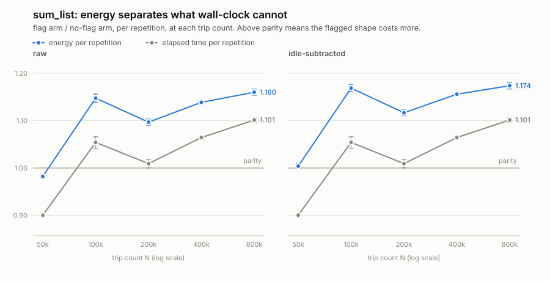

# eager-materialization / sum_list — energy–time decoupling

**This file is generated by `etdc/rig/report.py` and is never hand-edited.** Regenerate it with:

```sh
python3 -s -m etdc.rig.report rows.jsonl --out .
```

It is deterministic — every date below comes from the rows, not from the clock — so regenerating it and finding an empty `git diff` is the test that it still matches `rows.jsonl` beside it. It is also only *one* view: the rows are the artifact, and every number here is recomputable from them.

## The finding

At N = 800,000, the flagged arm costs **1.101×** the no-flag arm in elapsed time (±0.005) and **1.174×** in energy (±0.007).

> **Decoupling at N = 800,000: 1.066 ±0.003** (idle-subtracted) · 1.053 ±0.003 (raw)

Verdict: **energy-distinct** — energy separates the two arms by more than the time ratio explains.

A decoupling of 1.0 would mean energy says exactly what the clock already said: a speed rule wearing a green hat, and not worth having as a separate rule. The threshold used is 3×SEM from parity.

**Across the ladder** the decoupling runs from 1.066 ±0.003 at N = 800,000 to 1.115 ±0.006 at N = 50,000, and is distinguishable from parity at every point measured. The headline above quotes the smallest of these, so it understates the rest.

At N = 50,000 the time ratio is **0.900 ±0.004** — the flagged shape is *faster*. Energy at the same point is 1.004 ±0.006. Wall-clock does not merely fail to see this cost; it points the other way.

Slope of the decoupling quotient against trip count: **-0.041 per decade of N** (±0.008) — the quotient declines as N grows.

That is the opposite of what harness dilution would produce. Dilution is a roughly constant per-iteration overhead, so its share shrinks as N grows and it pushes the quotient *up* with N; a quotient that falls instead means something else dominates. Here it is the time ratio: it climbs with N while the energy ratio stays flatter, so their quotient shrinks.

## The two arms

Identical `build()`, identical data, identical arithmetic. Only the shape differs:

```python
# flag — the shape present
return sum([x * x for x in data])

# no-flag — the shape absent
return sum(x * x for x in data)
```

## ratio(N)



Energy domains: `package-0 + dram`. Ratios are per repetition (E/R and T/R), so R may differ between arms. Uncertainty is ±SEM over the adjacent-pair ratios.

| N | R | pairs | time ratio | energy ratio (raw) | decoupling (raw) | energy ratio (idle-subtracted) | decoupling (idle-subtracted) |
|---:|---:|---:|---:|---:|---:|---:|---:|
| 50,000 | 404,449 | 10 | 0.900 ±0.004 | 0.982 ±0.004 | 1.091 ±0.005 | 1.004 ±0.006 | 1.115 ±0.006 |
| 100,000 | 169,183 | 10 | 1.054 ±0.012 | 1.147 ±0.009 | 1.089 ±0.006 | 1.169 ±0.008 | 1.109 ±0.007 |
| 200,000 | 83,86 | 10 | 1.009 ±0.009 | 1.097 ±0.007 | 1.087 ±0.004 | 1.117 ±0.006 | 1.107 ±0.005 |
| 400,000 | 39,42 | 10 | 1.064 ±0.004 | 1.139 ±0.004 | 1.070 ±0.003 | 1.156 ±0.004 | 1.086 ±0.004 |
| 800,000 | 19,21 | 10 | 1.101 ±0.005 | 1.160 ±0.007 | 1.053 ±0.003 | 1.174 ±0.007 | 1.066 ±0.003 |


Both panels share a y-axis. The idle-subtracted panel removes `P_idle × duration` per domain, measured from idle windows taken *between* runs rather than once at pin time — the idle term rides along with duration, so leaving it in drags the energy ratio toward the time ratio and understates whatever is there. A negative `E_active` is never clamped; it is reported as a failed check.

## Method

- **Energy domains:** `package-0 + dram`. `core`/`uncore` are subzones of `package-0`, so summing them would double-count; `psys` is excluded because it reads below `package-0 + dram` on this rig. All domains are recorded on every row regardless — a domain can be dropped from a sum later, but cannot be recovered if it was never captured.
- **Window floor:** 1.0 s. Relative error is roughly (RAPL refresh period / window length) and a ratio of ratios compounds it.
- **R calibration:** each `(arm, N)` was probed and R scaled to a 1.15 s window. Per arm as well as per N, since the arms of a pair can differ enormously in speed and ratios divide by R anyway.
- **Interleaved arms.** Every ratio is formed from two adjacent windows, so drift between repetitions cancels inside the ratio instead of landing entirely on whichever arm ran first.
- **Per repetition.** Ratios divide by R, so R may differ between arms without affecting the comparison.
- **Statistic:** mean ±SEM over the adjacent-pair ratios. The decoupling quotient is better-conditioned than either ratio it is built from, because time and energy noise are correlated and the common mode cancels.

## Promotion checks

| check | result | detail |
|---|---|---|
| one interpreter across the campaign | pass | cpython 3.14.4 (/usr/bin/python3) |
| one git SHA across the campaign | pass | 6fc254c45917 |
| tree was clean throughout | pass | no row measured against uncommitted changes |
| child was pinned | pass | every row measured on a pinned core |
| one RAPL domain set | pass | core, dram, package-0, psys, uncore |
| failed rows are present and explained | pass | no failed rows |
| no negative E_active | pass | none |
| every window at or above the floor | pass | none |
| an idle window exists to subtract | pass | 5 usable idle window(s) |
| every point has at least 3 ratio pairs | pass | couples per point: 10, 10, 10, 10, 10 |

All checks pass.

## Provenance

| | |
|---|---|
| rule / pair | `eager-materialization` / `sum_list` |
| git SHA | `6fc254c45917ed459518b70c1745a79b8cc2d850` |
| tree clean | yes |
| child pinned | yes |
| interpreter | cpython 3.14.4 — `/usr/bin/python3` |
| kernel / machine | 7.0.0-38-generic / x86_64 |
| RAPL domains seen | core, dram, package-0, psys, uncore |
| rows | 100 measured, 5 idle, 10 probe, 0 failed |
| measured | 2026-10-20T22:43:00.904294+00:00 → 2026-10-20T22:45:17.568766+00:00 |

